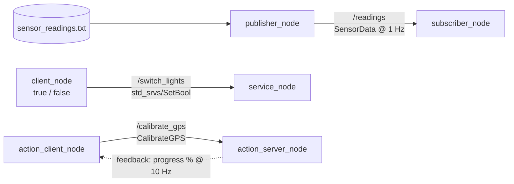

# Project 1: ROS 2 Sensor Processing

**Individual assignment** · April 2026 · University of Klagenfurt · Python / `rclpy` · [Full report (PDF)](docs/report.pdf)

A ROS 2 system for a mobile robot with a GPS sensor. Sensor readings (status, temperature and
x/y/z position) are read from a file, published at 1 Hz and processed by a subscriber that
watches for overheating and adds up the distance travelled. A service switches the robot's lights,
and an action simulates GPS calibration with progress feedback.

## Architecture



## Packages

| Package | Type | Contents |
|---------|------|----------|
| `my_robot_interfaces` | `ament_cmake` | `msg/SensorData.msg`, `action/CalibrateGPS.action` |
| `my_robot_package` | `ament_python` | Six nodes and the sensor data file (`include/sensor_readings.txt`) |

**Custom interfaces**

```
# SensorData.msg              # CalibrateGPS.action
string    status              bool start        # goal
float32   temperature         ---
float32[] position            bool success      # result
                              ---
                              float32 progress  # feedback
```

## Nodes

| Node | What it does |
|------|--------------|
| `publisher_node` | Reads the whole file once at startup and splits it into `*****`-separated blocks. Invalid blocks are logged and skipped so bad input can't crash the node. A timer publishes one `SensorData` message per second and stops when the data runs out. |
| `subscriber_node` | Logs the status, warns when the temperature is above 30 °C, checks that the position has exactly 3 values, and adds up the Euclidean distance between consecutive positions. Only the previous position is stored, so each step costs O(1). |
| `service_node` | `/switch_lights` (`SetBool`): replies `ON` or `OFF`. |
| `client_node` | Takes `true` or `false` from the command line, waits up to 5 s for the service (never loops forever), then calls it asynchronously through a future. |
| `action_server_node` | Simulates a 5 s calibration and sends progress feedback at 10 Hz (50 steps). |
| `action_client_node` | Sends the goal asynchronously and uses callbacks to handle goal acceptance, feedback and the final result. |

## Build and run

```bash
cd 01-ros2-sensor-processing
colcon build --symlink-install     # --symlink-install lets publisher_node find include/sensor_readings.txt
source install/setup.bash
```

Each line below runs in its own terminal:

```bash
# Topics
ros2 run my_robot_package publisher_node
ros2 run my_robot_package subscriber_node

# Service
ros2 run my_robot_package service_node
ros2 run my_robot_package client_node true

# Action (bonus)
ros2 run my_robot_package action_server_node
ros2 run my_robot_package action_client_node
```

## What I learned

- When to use a topic, a service or an action: a stream of data, a quick request/response, or a long-running task with feedback
- Defining and generating custom interfaces with `rosidl`
- Non-blocking patterns: timers instead of sleep loops, `call_async` with futures, and callback chains on the action client
- Defensive input handling, so one bad record doesn't bring down the pipeline
