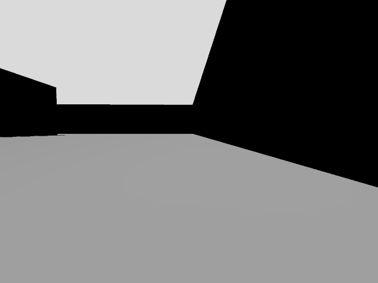
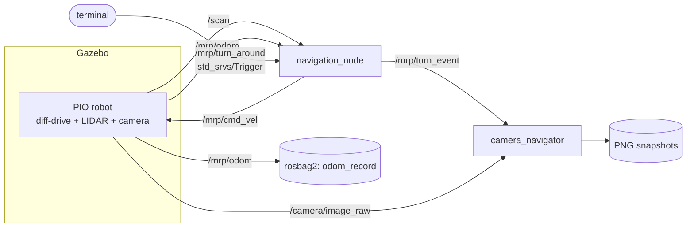

# Project 2: Gazebo Corridor Navigation

**Team project (3 students)** · May 2026 · Python, Gazebo Harmonic, `ros_gz_bridge` · [Full report (PDF)](docs/report.pdf)

A custom two-wheeled robot with a caster wheel drives laps on its own around a square corridor
(10 × 10 m outer walls, 4 × 4 m inner walls). It uses LIDAR to follow the walls without hitting
them, turns 180° on command, records its odometry to a rosbag, and saves a camera image just
before every turn.

<p align="center">
  
  <br><em>Onboard camera image taken automatically just before a 180° turn</em>
</p>

## My role

**Navigation and testing:** the LIDAR-based movement logic, wall-distance correction, 90° turns,
the 180° turn service, odometry recording, connecting the camera, and final testing.

Alesia Shauchuk built the Gazebo world and the robot model (body, wheels, caster, LIDAR, camera).
Vadim Kuznetsov set up ROS 2: the launch file, bridge configuration, topic checks, RViz and robot spawning.

## System overview



All Gazebo and ROS 2 traffic goes through `ros_gz_bridge` (see `config/bridge_config.yaml`).

## Robot model

| Parameter | Value |
|-----------|-------|
| Body | 0.35 × 0.25 × 0.10 m |
| Drive wheels | r = 0.05 m, width 0.04 m, 0.145 m from centre |
| Total width (incl. wheels) | 0.33 m |
| LIDAR | `gpu_lidar` with Gaussian noise, mounted 0.04 m behind centre |
| Camera | RGB, front-mounted, `/camera/image_raw` |

## Navigation logic (`scripts/navigation_node.py`)

A 10 Hz control loop with two modes, `NAVIGATE` and `TURNING`.

- **Sector-based perception:** the scan is split into seven angular sectors (front, front-left/right,
  left/right, far-left/right). The *median* range of each sector is used instead of the minimum,
  so single noisy beams don't trigger false reactions.
- **Wall following:** the robot picks the nearer wall within 1 m and keeps about 0.62 m from it.
  - closer than 0.37 m: slow down and steer away
  - farther than 0.72 m: steer gently back towards the wall
  - otherwise: drive straight at cruise speed
  - the opposite wall is always checked too, and the robot steers away from it if it gets too close
- **Corner detection:** front < 0.75 m *and* one side < 0.40 m means a corner, so the robot makes a 90° turn
  away from the near wall. If an obstacle comes within 0.5 m in front, it makes an emergency turn
  towards the more open side.
- **Closed-loop turns:** the turn angle is measured from odometry yaw (quaternion → yaw, wrapped to [−π, π]).
  The robot turns at 0.7 rad/s and slows to 0.3 rad/s for the last 0.2 rad, stopping within a 0.02 rad tolerance.
  A 1.5 s cooldown stops it from oscillating in tight corners.
- **On-demand U-turn:** the `/mrp/turn_around` service (`std_srvs/Trigger`) starts a 180° turn, after which
  the robot keeps navigating in the opposite direction.
- **Turn events:** every turn publishes a message such as `turn_90_left` on `/mrp/turn_event`.
  `camera_navigator` listens for these and saves the latest camera frame as a PNG.

## Build and run

```bash
cd 02-gazebo-corridor-navigation
colcon build --symlink-install
source install/setup.bash

# Gazebo + RViz + bridge + robot spawn + navigation node
ros2 launch pio_description display.launch.py
```

In other terminals:

```bash
# 180° turn on command
ros2 service call /mrp/turn_around std_srvs/srv/Trigger

# Camera snapshots on every turn (saved to ~/ros2_ws/src/pio_description/camera_images)
ros2 run pio_description camera_navigator.py

# Record odometry
ros2 bag record /mrp/odom -o bags/odom_record
```

## Recorded data

`bags/odom_record/` contains a 135 s recording of `/mrp/odom` (6,460 `nav_msgs/Odometry` messages, MCAP format).
To inspect or replay it:

```bash
ros2 bag info bags/odom_record
ros2 bag play bags/odom_record
```
