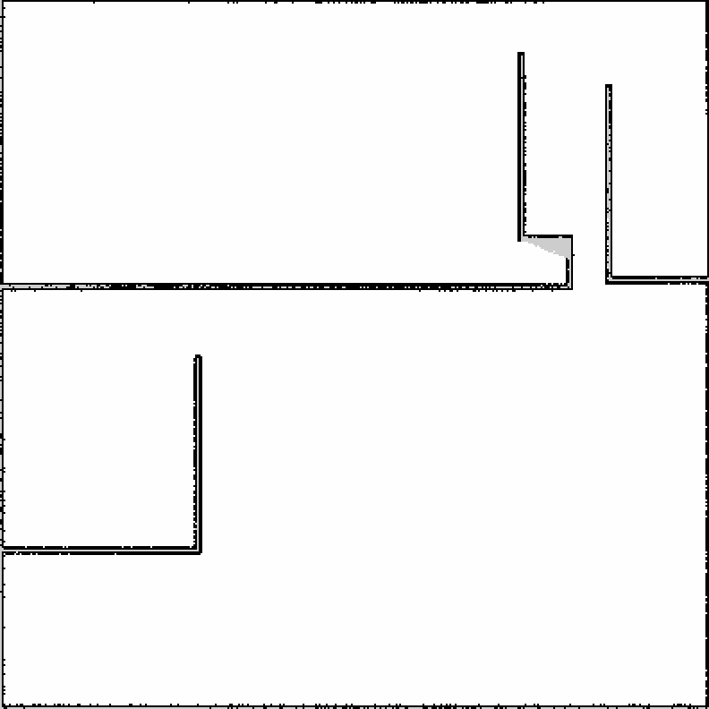
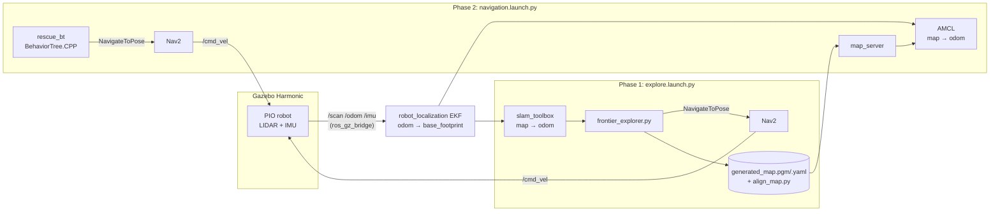
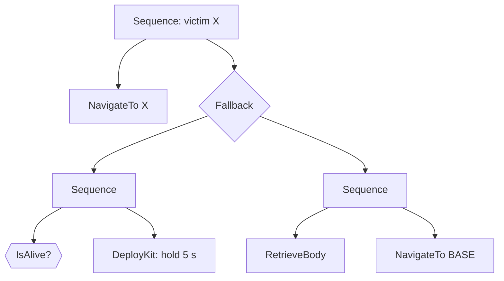

# Project 3: Maze SLAM and Search & Rescue

**Team project (3 students)** · June 2026 · C++ and Python · Nav2, slam_toolbox, AMCL, robot_localization, BehaviorTree.CPP
· [Full report (PDF)](docs/report.pdf) · [Presentation slides (PDF)](docs/slides.pdf)

The PIO robot starts at (−7.0, −6.5) in an unknown Gazebo maze. It explores the maze **on its own**,
builds and saves a map, and drives back to the start. Then it uses the saved map for a mock
**search-and-rescue mission**: it drives to three victims, checks each one's status, and reacts through
a behavior tree.

<p align="center">
  
  <br><em>Map built autonomously with frontier exploration and slam_toolbox (0.05 m/cell)</em>
</p>

## My role

**Search-and-rescue behavior tree:** the tree structure, victim-status handling,
final validation of the whole mission, and the report.

Alesia Shauchuk built the Gazebo world, the robot model and the package assets.
Vadim Kuznetsov did the navigation and testing: ROS 2 setup, launch files, bridge configuration, RViz,
Nav2 bring-up and the SLAM checks.

## Pipeline



**TF tree:** `map → odom → base_footprint → base_link → {lidar_link, imu_link, wheels}`.
The rule that fixed the maps was **one publisher per TF edge**. In an earlier version two nodes both
published `odom → base`, the pose kept jumping between them, and every scan was smeared into the map
at the wrong place.

## Phase 1: Autonomous exploration and mapping

`scripts/frontier_explorer.py` (Python) works through these steps:

1. Read the live `/map` from slam_toolbox (online async mode, 0.05 m resolution, loop closure on).
2. Find **frontier cells**: free cells next to unknown space. Group them into clusters and ignore clusters smaller than 5 cells.
3. Score each cluster as `size / (distance + 1)`. This prefers large frontiers that reveal more area, without sending the robot unnecessarily far.
4. Move the goal from the cluster centre to a safe free cell, then send it to Nav2 (`NavigateToPose`). The Nav2 planner runs with `allow_unknown: true`.
5. If a goal is rejected, fails or times out (40 s), add it to a blacklist and pick the next frontier.
6. When no frontiers are left, save the map with `map_saver_cli`, align it to the world frame and drive back to the start.

**Map alignment** (`scripts/align_map.py`): slam_toolbox starts the map frame at the spawn pose,
so the saved map's origin is shifted by the spawn offset (−7.0, −6.5). After that, world-frame victim
coordinates and the AMCL initial pose can be used directly.

## Phase 2: Search & rescue behavior tree

The tree is written in BehaviorTree.CPP v4 (`behavior_trees/rescue.xml`). The custom C++ nodes are in
`include/pio_maze/bt_nodes.hpp` and the executor in `src/rescue_bt.cpp`.

| Node | Type | Behaviour |
|------|------|-----------|
| `NavigateTo` | `StatefulActionNode` | Sends a Nav2 `NavigateToPose` goal and stays `RUNNING` until the result arrives. The goal is cancelled if the node is halted. |
| `IsAlive` | `ConditionNode` | `SUCCESS` if the victim's status is `ALIVE` |
| `DeployKit` | `StatefulActionNode` | Prints the rescue message and holds for 5 s of **sim time** without blocking the tree |
| `RetrieveBody` | `SyncActionNode` | Prints the body-retrieval message |
| `SaySomething` | `SyncActionNode` | Prints the mission-complete message |

Every victim uses the same subtree:



| Victim | Location | Status | Robot's reaction |
|--------|----------|--------|------------------|
| A | (−7.0, −1.0) | DEAD | Retrieve the body and return to base |
| B | (9.0, 4.0) | ALIVE | Deploy the rescue kit for 5 s |
| C | (8.0, −8.5) | ALIVE | Deploy the rescue kit for 5 s |

After the last victim the robot returns to base and reports that the mission is complete.

## Build and run

```bash
cd 03-maze-slam-search-and-rescue
colcon build --packages-select pio_maze --symlink-install
source install/setup.bash

# Phase 1: autonomous exploration and mapping (exploration starts about 45 s after launch)
ros2 launch pio_maze explore.launch.py gui:=true rviz:=true

# Phase 2: localization on the saved map and the rescue mission (the BT starts about 20 s after launch)
ros2 launch pio_maze navigation.launch.py gui:=true rviz:=true
```

Useful launch arguments: `explore:=false` (mapping without exploration), `rescue:=false` (navigation only),
`map:=/path/to/map.yaml`.

## Results

- The maze was mapped with no teleoperation and no manually chosen goals. The walls in the map are clean and straight, with no smearing.
- On the saved map the robot reached all three victims, chose the correct branch each time, returned to base after victim A, and finished the mission.

## Lessons learned

- Get the basics right first: collision geometry, the TF tree and the shared sim clock. SLAM and Nav2 are only as good as the odometry and frames underneath them.
- Simple primitive shapes for collisions (cylinder wheels, sphere casters) gave much more reliable odometry than detailed meshes.
- Behavior trees make mission logic easy to read and change: adding a victim only takes a few lines of XML.
