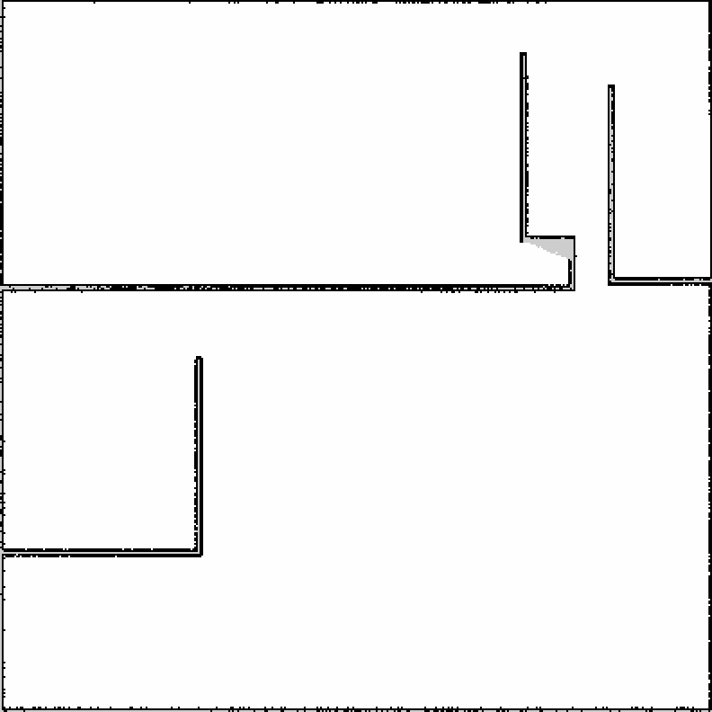

# Mobile Robot Programming: ROS 2 Projects


Coursework from **Mobile Robot Programming (700.240, Summer Semester 2026)**.
The three projects build on each other. The first covers the core ROS 2 communication patterns.
The second is a custom differential-drive robot that navigates a Gazebo world on its own.
The third is a robot that maps an unknown maze with SLAM and then carries out a
search-and-rescue mission driven by a behavior tree.

<p align="center">
  
  <br><em>Maze map built autonomously by the robot with frontier exploration and slam_toolbox (Project 3)</em>
</p>

## Projects

| # | Project | Highlights | Team | Stack |
|---|---------|-----------|------|-------|
| 1 | [**ROS 2 Sensor Processing**](01-ros2-sensor-processing) | Custom message and action interfaces; publisher/subscriber, service/client and action server/client nodes for a simulated GPS sensor | Individual | Python, `rclpy` |
| 2 | [**Gazebo Corridor Navigation**](02-gazebo-corridor-navigation) | Custom differential-drive robot (SDF), LIDAR wall-following with median filtering, corner detection, on-demand 180° turn service, odometry rosbag, camera snapshots at every turn | 3 students | Python, Gazebo, `ros_gz_bridge`, rosbag2 |
| 3 | [**Maze SLAM and Search & Rescue**](03-maze-slam-search-and-rescue) | Frontier-based autonomous exploration, slam_toolbox mapping, EKF sensor fusion, AMCL localization, Nav2 navigation, BehaviorTree.CPP rescue mission | 3 students | C++, Python, Nav2, slam_toolbox, BehaviorTree.CPP |

## Skills demonstrated

- **ROS 2 fundamentals:** topics, services, actions, custom `.msg`/`.action` interfaces, timers, async futures and callbacks, parameters, launch files
- **Simulation:** writing SDF/URDF/xacro robot models and Gazebo worlds, LIDAR, IMU and camera sensors with noise, connecting Gazebo and ROS 2 with `ros_gz_bridge`
- **Reactive control:** sector-based LIDAR processing, wall following, corner detection, closed-loop odometry turns
- **Mapping and localization:** SLAM (slam_toolbox), occupancy grids, map saving and frame alignment, AMCL particle-filter localization, EKF fusion of wheel odometry and IMU (`robot_localization`)
- **Planning and autonomy:** Nav2 (planner, controller, costmaps, lifecycle management), frontier exploration with clustering, scoring and blacklisting
- **Mission logic:** behavior trees with BehaviorTree.CPP v4 (custom stateful actions, conditions, fallbacks), Nav2 action clients in C++
- **Engineering practice:** TF tree debugging (one publisher per transform edge), sim-time synchronization, bottom-up testing, data recording with rosbag2

## My contributions

| Project | My role |
|---------|---------|
| 1 | Sole author: design, implementation and report |
| 2 | Navigation and testing: LIDAR-based movement logic, wall-distance correction, 90° turns, the 180° turn service, odometry recording, camera integration, final testing |
| 3 | Search & rescue: behavior tree structure, victim-status handling, final validation, report |

Teammates on Projects 2 and 3: **Alesia Shauchuk** (Gazebo worlds and robot models) and
**Vadim Kuznetsov** (ROS 2 setup, launch files, bridge, RViz, Nav2 bring-up). Each project
README describes the full split of work.

## Repository layout

```
.
├── 01-ros2-sensor-processing/      # Project 1: a colcon workspace
│   ├── src/                        #   ROS 2 packages
│   └── docs/report.pdf             #   written report
├── 02-gazebo-corridor-navigation/  # Project 2
│   ├── src/  bags/  media/  docs/
└── 03-maze-slam-search-and-rescue/ # Project 3
    ├── src/  media/  docs/         #   docs/ also contains the presentation slides
```

Each project folder is a self-contained **colcon workspace**. To build one:

```bash
cd 02-gazebo-corridor-navigation
colcon build --symlink-install
source install/setup.bash
```

## Environment

- Ubuntu 24.04 with **ROS 2 Jazzy**
- **Gazebo Harmonic** (`ros_gz`)
- Project 3 also needs `nav2_bringup`, `slam_toolbox`, `robot_localization` and `behaviortree_cpp`

```bash
sudo apt install ros-jazzy-ros-gz ros-jazzy-navigation2 ros-jazzy-nav2-bringup \
  ros-jazzy-slam-toolbox ros-jazzy-robot-localization ros-jazzy-behaviortree-cpp \
  ros-jazzy-xacro ros-jazzy-cv-bridge
```

## License

My code is released under the [MIT License](LICENSE). The maze model in Project 3
(`models/turtlebot3_playground`) is third-party; its author is credited in its `model.config`.
